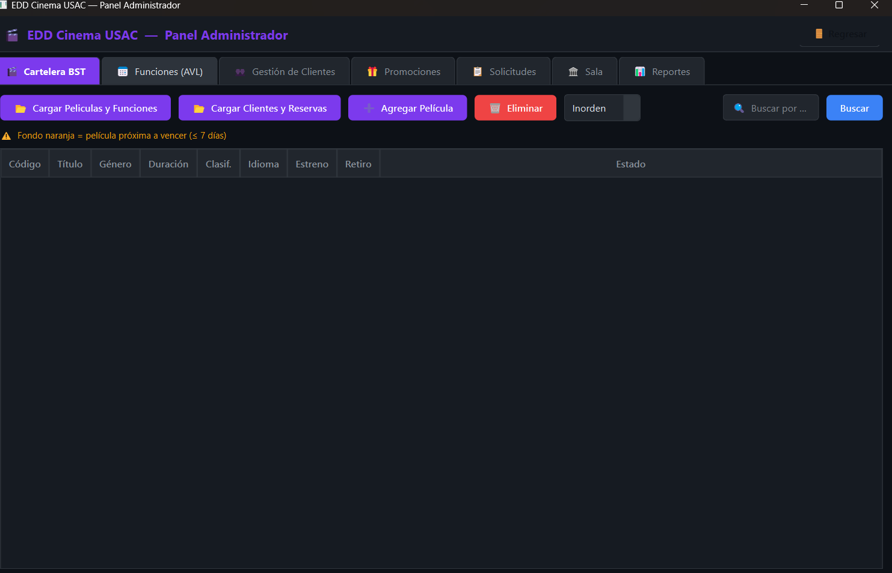
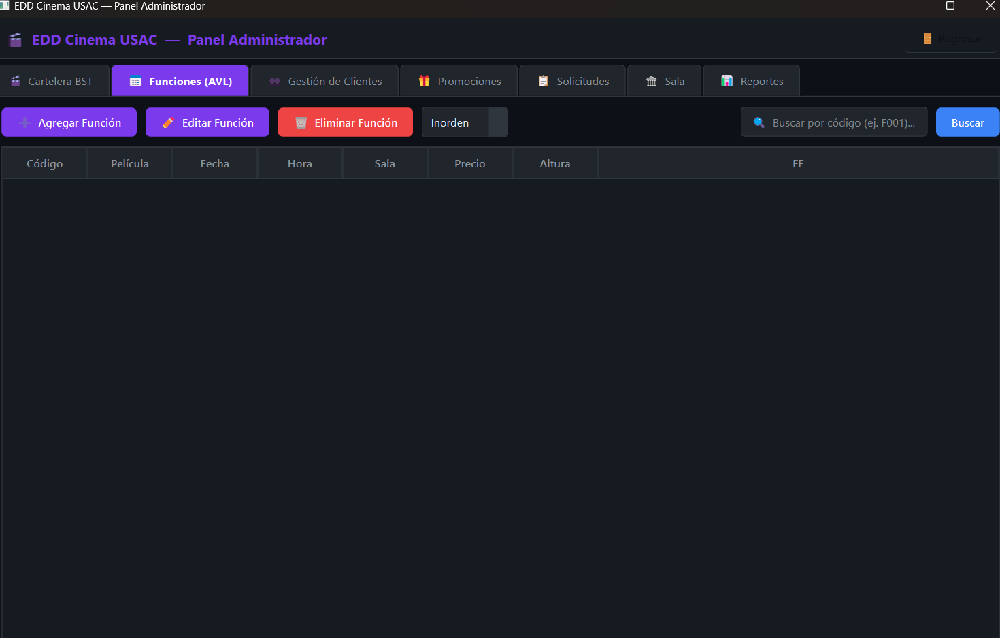
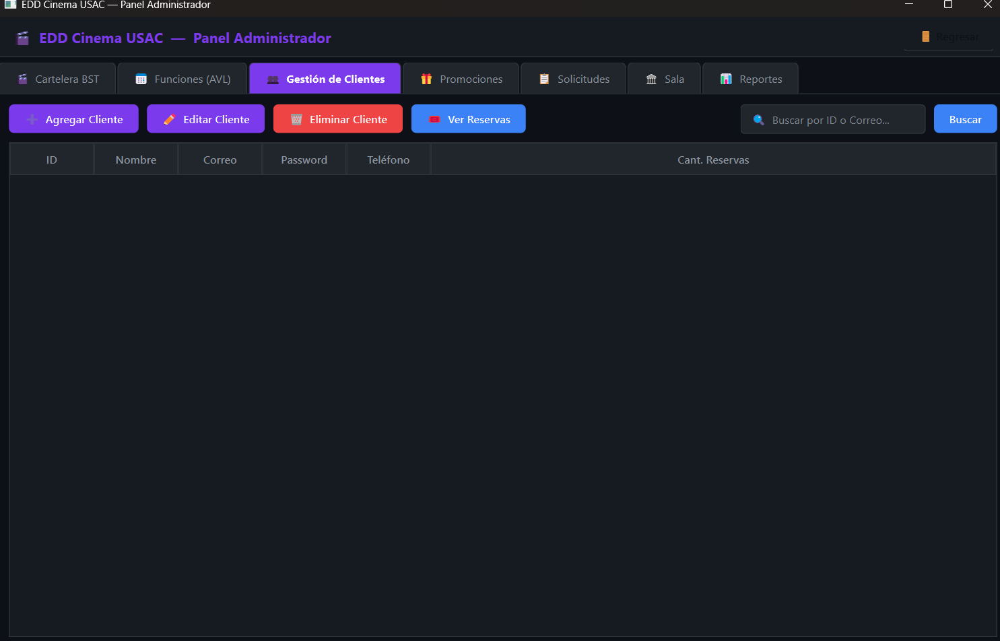
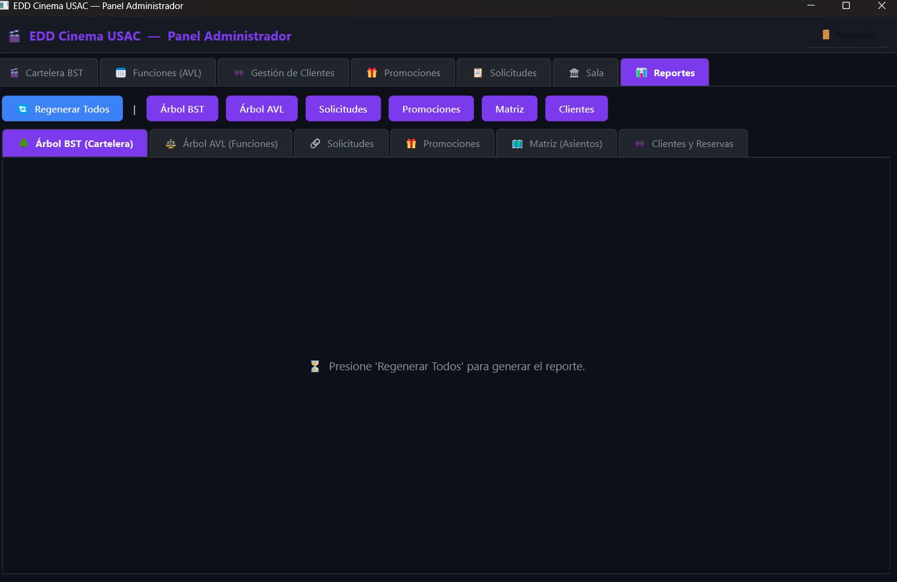

# Manual de Usuario Oficial y Arquitectura de Operación - CinemaUSAC (Fase 2)

***

## 1. Introducción y Bienvenida a la Experiencia CinemaUSAC

Te damos la más grata bienvenida a **CinemaUSAC**, el sistema corporativo automatizado de gestión integral y reserva de boletaje de cine más veloz y optimizado de la industria departamental.

Nuestra visión fundacional con CinemaUSAC es la total erradicación del papel físico y la fragmentación informática. Hemos cohesionado todos tus módulos indispensables (Venta al Público, Mantenimiento Corporativo de Películas y Analítica en Tiempo Real) en una única plataforma de ventanas responsivas e intuición moderna.

### 1.1 Funciones Principales del Sistema
- Control simultáneo de Múltiples Funciones Cinematográficas en paralelo.
- Resguardo de cuentas con validación rigurosa DPI universal de por vida.
- Taquilla Matrix: Asignación virtual visual interactuando al click sobre butacas reales con colores de diagnóstico para un uso nulo de texto y un uso 100% gráfico.
- Monitoreo estadístico global: Motor que ilustra la sanidad transaccional de todo tu cine con fotografías que el mismo sistema exporta solas.

### 1.2 Requisitos y Puesta en Ejecución (Hardware/Resolución)
- **Sistema Operativo:** Compatible íntegramente con Windows 10/11 (Arquitecturas 64 bits recomendadas para un manejo de ram desahogado durante Cargas Masivas), distribuciones estándar de Linux (Ubuntu, Fedora) o Entornos de macOS certificados.
- **Visualización:** Resoluciones superiores a `1366x768` (Se recomienda `1920x1080`) para acomodar la tabla extensa de las Butacas y de Cartelera sin entorpecer la accesibilidad visual.
- **Componentes Secundarios:** Una instalación general en las Herramientas del Sistema de **Graphviz**, esto permitirá la invocación del sistema de dibujos abstractos si requieres exportables a PDFs o fotos de mapas gráficos.

---

## 2. Escudo de Autenticación y Registro

El primer portal te dividirá según tus privilegios operacionales. Nuestra plataforma identifica y restringe la lectura visual dependiendo de la identidad.

### 2.1 Pantalla Principal — Iniciar Sesión (Staff y Clientes)
El formulario expide de primera instancia una vista simple solicitando dos credenciales: Correo y Contraseña.

Si el usuario entrante consiste del equipo Root (Administradores con capacidades destructivas o creadoras masivas):
* **Usuario/Correo Root:** Escribir el estipulado durante la configuración por el grupo de tecnología (Puntualmente con privilegios de `admin@...`).
* **Contraseña Asignada:** Credencial de alto riesgo para el inicio.
Haz clic sobre el panel central "Iniciar Sesión" (o presiona la tecla INTRO/ENTER).

### 2.2 Portal de Altas de Taquilla (Registrar Nuevo Cliente)
Si un usuario es nuevo consumidor, necesita su Identidad Digital Inamovible para proceder a apartar salas comerciales.
1. Localiza sobre las tarjetas del lateral el botón destinado al proceso de **Registrarse** (El ícono general te acompañará).
2. Un vasto formulario presentará las validaciones. Debes llenar:
   * Información Nominal Exigida: *Nombres, Apellidos, Edades.*
   * **El identificador Primario (Código de Barras/DPI)**: Este no debe existir en otro miembro en la base global histórica para impedir usurpación de asientos digitales, nuestro sistema Árbol buscará velozmente que esté disponible.
3. Termina de establecer un Correo con sintaxis formal estándar `@` y contraseñas.
4. Efectúa el envío mediante el botón final aceptador. Si los valores están probados el registro guardará la semilla internamente en los nodos.

***

## 3. Entorno de Administración (Dashboard de Mantenimiento Absoluto)

Una vez acreditado con la super credencial (Administrador), desbloquearás todas las mecánicas que nutren de contenido y cartelería a los cines públicos nacionales.

### 3.1. Gestión Avanzada del Catálogo (Las Películas)
Para poder despachar entradas, la sala necesita poseer Catálogos (Las cintas de cine).
* **Inspeccionando Películas (Filtros Reales):** La cartelera izquierda no es estática, responde dinámicamente utilizando jerarquías estructuralizadas (Árbol Binario Algorítmico). Apretar de tu lado superior los botones con nombres matemáticos **"PreOrden", "InOrden" o "PostOrden"** causará un flujo instantáneo y rediseñable sobre la forma alfabética en que los títulos bajan a tu panel visual de búsqueda.
* **Agregado y Editado:** Localiza la caja lateral derecha e ingiere tus textos en `Id`, `Titulo` y su indispensable `Sinopsis/Tiempo/Director`. Botón Inferior "Agregar Película" (Recuerda que no sobre-escribe si los identificadores colisionan, garantizando protección de películas anteriores).

### 3.2. Estructuración y Eliminación de Funciones (Horarios Reales)
Ninguna película puede proyectarse sin asignar una Función de Exhibición en Calendario. 
1. Navega hacia las Pestañas de **"Ajustes de Sistema y Función"**.
2. **Crea la Función:** Necesitas crear la Función vinculando un código único del cine (C0F_1, Función 102), escoge la película del selector (combobox), fija el horario pico y un costo en moneda general.
3. *OJO con las interacciones:* La modificación o la supresión de la misma al utilizar el Destructor ("Eliminar") destruye colateralmente todos los reportes, datos asíncronos Json locales y vacía las salas vendidas que habían a nombre de esas funciones, perdiendo por completo registros irrecuperables. 

### 3.3. Administración y Carga Masiva (Clientes de Bases de Datos)
El sistema suprime las digitaciones repetitivas de 300 o más transacciones habilitando el proceso por lotes "Archivos .JSON".
En tus vistas de **"Carga de Clientes"**, la sección habilita subidas estandarizadas JSON de estructuras multi-niveladas. Presionando el Selector de archivos te emergerá el explorador local (Windows/Mac). Seleccionado correctamente, verás una lluvia en el listado de cada usuario, dpi y correo anidado a tu matriz B-tre sin que colisione ni cuelgue tu pantalla.
Si requieres, desde la matriz derecha, puedes investigar todos los expedientes manuales cliqueando el Histórico y las Edades para censuras R-Rating visualizando en el buscador.

***

## 4. Módulo de Puntos de Venta (Cliente Espectador)

Cuando un perfil no goza de poderes administrativos, la pantalla asume una modalidad minimalista, diseñada para que el abuelo, el joven y la profesional entablen sus pedidos de inmediato sin fricción en una ventana limpia.

### 4.1. Cartelera y Matrices Oculares
El Lobby transiciona a la cartelera comercial de cara al usuario.
1. Haces Clic sobre la oferta Cinematográfica deseada dentro del Panel Listado o los Combo Selectores.
2. Un campo revelará los horarios anexos creados por la directiva del cine en la Etapa de Funciones.
3. Al seleccionar y comprometer cuál deseas asistir emergerá la **SALA O MATRIZ ESTÁTICA DISPERSA**.
4. ¡Espectacular y sencillo! Toda celda o bloque que tu ojo distinga en VERDE indica Asientos Libres que flotan esperando para tu selección; Todo lo ROJO es un candado irreversible propiedad de otro espectador anterior al tuyo.
5. Al hacer Clic en la matriz y darle Reservar (Doble autenticación a tu usuario), emitirá el Código o TICKET del boleto irrepetible.

### 4.2. Bandeja de Salida (Tus Boletos Viejos)
Si lograste apartar con éxito o el estrés te asalta y re-piensas el gasto del mismo asiento:
- La Pestaña Personal aloja todas tus transferencias y consumos divididos cronológicamente con estados de **Asientos Ocupados Válidos**.
- Apuntando al registro que quieres y presionando la Tecla o Botón Cancelar, devolverás al motor interno las coordenadas F/C (Fila y Columna), se restaurarán solas al color Verde general dejando libre el comercio sobre esa butaca, erradicando tu llave secreta de inmediato.

***

## 5. Analítica Gráfica Exportable (Renderización al Vuelo de Graphviz)

Si eres un Administrador Ejecutivo y el reporte financiero o estructural IT es exigido para mantenimiento. Esta pestaña expide toda la estructura programática interna en infografías coloridas e ingeniosas y sin intervención manual de dibujar diagramas en software terciario.

1. Navega hacia **Reportes Administrativos**.
2. Los botones de Renderización dictaminan a qué catálogo inmenso realizar los cuadros:
   * **BST (Catálogo Películas):** Ve al catálogo ordenado numéricamente a través de ramales derechos o izquierdos lógicos de manera fotográfica descendente.
   * **AVL Proyecciones:** Certifica si tu organización de horarios está estática o es profunda (Factorizando).
   * **Árbol de Cliente DPI B-Tree:** Imprime tablas (HTML Nodes) aglomerando a todo DPI por cada página y color en hojas del diagrama de manera masificada.
   * **Hashing Estricto Tickets:** Extrae fotográficamente la tabla interna listando todo asiento apartado global, enumerando colisiones (mismo espacio hash que fue reacomodado como la lista lateral encadenada en cascada).
3. Haces "Clic" en cualquiera y la imagen es cocinada internamente y sobreimpresa como el visor gris lateral al instante demostrando lo expuesto. Asimismo, encontrarás toda fotografía grabada vectorialmente real (`Reportes.png`, etc.) salvada nativamente en la Carpeta `/imagenes` que anida el binario de tu servidor principal para adjuntar en Pdf o por Correo Institucional de Trabajo.

***

## 6. Resolución de Conflictos (Troubleshooting General de Taquilla)

* **Problema: El Botón de Inicio o Confirmación "Crashea" o el sistema Cierra súbitamente luego de ingresar un JSON muy Inmenso.**
  **Solución Preventiva:** Esto ocurre a nivel de Kernel RAM cuando la estructura interna del JSON importado se desvía de los corchetes o el formateo (Keys como *id_pelicula* escritos al revés con typo en lugar de *id_peliculas*). Valide la pureza e indentación final y reinicie, los JSON anteriores están salvaguardados al ser transaccionales. Si recae, revise la consistencia null.
* **Problema: La Matriz me indica disponible un Asiento en la Interfaz, pero al clickear rechaza mi acción o da error silencioso.**
  **Solución Preventiva:** Interrupción de Hilos Visuales; el sistema matriz disperso ha liberado internamente ese campo debido a que alguien canceló, pero el dibujo (El repintado virtual del color de esa celda en Qt) falló o tiene lag en su monitor. Refresca la función o selecciona otra matriz para vaciar forzosamente las instancias visuales y regresar a la deseada.
* **Problema: Al Crear cliente lanza aviso que es Duplicado o ID Ocupado.**
  **Solución Preventiva:** Has usado un DPI en la base, verifíquelo o revise las bandejas.

